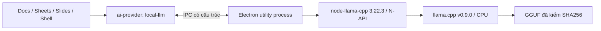

# Chat local LFM3-VL-2B

Provider `local` là mặc định của cài đặt mới hoặc chưa từng chọn provider. Lựa chọn Gemini,
Agy và các provider đã lưu được giữ nguyên. Agy vẫn có trong danh sách. OCR trên Windows
vẫn ưu tiên TrueOCR; thay đổi này không đưa ảnh OCR sang chat hay dịch vụ cloud.

## Kiến trúc và vận hành



Không có HTTP, SSE, Python, Ollama hay llama-server trong đường chạy production. Script
`bench-http.mjs` chỉ đo đối chứng với kiến trúc cũ. Package `@genoffice/local-llm` không phụ
thuộc Electron; `child_process.fork` với `serialization: 'advanced'` được dùng ở benchmark.
Các entry point Electron dùng cùng adapter `electron-utils/local-chat`; shell bổ sung quản lý
tải model và giao diện. Ứng dụng standalone đọc cùng đường dẫn trong userData của nó;
quản lý/tải model qua giao diện shell hoặc đặt file đã xác minh vào thư mục tương ứng.

Host nạp lười, giữ model/KV cache trong 10 phút mặc định và unload khi rảnh. Mỗi request mang
toàn bộ lịch sử; `LlamaChat` quản lý lịch sử bên ngoài và tái sử dụng prefix KV trùng nhau.
Host chỉ nhận schema, trả tool call; agent-core thực thi. Host và provider kiểm allowlist;
dispatcher agent-core kiểm độc lập. `deleteBlocks` thiếu target bị từ chối, không sửa tham số.
Không có fallback từ local sang cloud; ảnh bị báo không hỗ trợ trước khi gọi host.

Client có các trạng thái STOPPED, STARTING, READY, BUSY, IDLE, STOPPING. Một request hoạt động
mỗi host; request đồng thời nhận lỗi BUSY. AbortSignal dừng sinh token. Nếu native decode bị
kẹt, sau 2 giây hủy sẽ bắt đầu shutdown; shutdown chờ exit, sau 5 giây gửi kill. Process crash
được báo `NATIVE_CRASH`, lần chat tiếp theo tạo host mới. Xóa model chờ host thoát trước khi
xóa file, đồng thời giữ khóa tải liên tiến trình. Environment host chỉ chứa biến hệ điều hành.

## Tải và cài đặt

- Mở Cài đặt → AI Model → Local · LFM3-VL-2B. Có tải, hủy, tiếp tục, xóa, tiến độ,
  giữ nóng, suy luận và phần nâng cao cho CPU threads/GPU/context.
- Shell tự tải nền khi local là provider hiệu lực và model chưa có; mặc định bật
  “Tự tải model khi cần”. Offline hiển thị trạng thái; Windows kiểm chi phí mạng bằng WinRT
  với timeout 5 giây và tạm dừng tự tải trên mạng tính cước. Nút Tải là lựa chọn thủ công.
  Dò chi phí là best effort; hệ điều hành không cung cấp kết quả thì trạng thái là unknown.
- Đường dẫn: `<userData>/models/lfm3-vl-2b/LFM3-VL-2B-Q4_K_M.gguf`.
  Có thể chép GGUF có sẵn vào đúng đường dẫn này khi app đã dừng; không có override qua env.
- Chỉ tải trực tiếp từ Hugging Face theo revision manifest. Range resume, retry, kiểm dung
  lượng đĩa và khóa tải dùng chung với pipeline embedding qua `main/model-artifacts`.
  File `.part` được giữ khi hủy/lỗi mạng. Chỉ chủ khóa được sửa/xóa partial.
- SHA256 thật được kiểm sau tải, lúc khởi tạo manager và mỗi lần host nạp model. Không dùng
  marker `.verified`, mtime hay size để bỏ qua băm. SHA sai bị xóa và báo lỗi.

Manifest pin `LiquidAI/LFM3-VL-2B-GGUF@1add221a5ea6c047fcf1eaaf2d247939d7cf8849`:

| File                        |          Byte | SHA256                                                             |
| --------------------------- | ------------: | ------------------------------------------------------------------ |
| LFM3-VL-2B-Q4_K_M.gguf      | 1,099,627,808 | `56dac2e192ff0d9ab8507f4f1aeb4aed0463449bbbefaac79497f041c95f21eb` |
| mmproj-LFM3-VL-2B-Q8_0.gguf |   203,031,872 | `c5c5b58d544a18da919172d2d0368090ea1a4a351b6feb7f8a326a264a5918ab` |

Projector chỉ được liệt kê optional/vision, **không tải trong v1**. Weights không nằm trong git
hay installer; `mirrorable: false`.

Sampling mặc định: temperature 0.1, top_k 50, top_p 1.0, min_p 0.0, repeat_penalty 1.1.
Thinking mặc định tắt bằng `budgets.thoughtTokens = 0`; bật trong cài đặt sẽ stream thought
sang reasoning riêng. Token điều khiển kết thúc thought có thể vẫn được thống kê là một
thought token khi tắt; nó không phải nội dung suy luận hiển thị trong câu trả lời.

Context mặc định tối đa 16,384. Với tổng RAM ≥24 GiB và RAM trống ≥8 GiB, người dùng có thể
chọn 32,768. Các mức trần còn lại là 16,384 khi trống ≥6 GiB, 8,192 khi ≥4 GiB, 4,096 khi
≥2.5 GiB. Dưới 2.5 GiB trống hoặc tổng RAM <4 GiB thì từ chối nạp. Đếm token bằng tokenizer
của model, gồm system/tool schema. Tràn context báo lỗi rõ ràng, không tự bỏ system prompt.
Output theo caller, tối đa 16,384 và phần context còn lại; stop reason báo khi chạm giới hạn.

CPU là mặc định. `auto`/`vulkan` là tùy chọn chủ động; installer chỉ gói backend CPU của nền
tảng build (mac-arm64 dùng binary có Metal nhưng `gpu:false`). GPU backend phải được triển
khai riêng. Vulkan trên Radeon 780M từng segfault khi load; không tự bật GPU. Host riêng giữ
crash native khỏi kéo renderer/main chết. Chọn **6 luồng** mặc định: gần tốc độ 8 luồng nhưng
chừa CPU cho giao diện; 16 luồng thực tế không hoàn tất trong timeout benchmark.

## Số đo trên Windows 11

Ryzen 7 8845H (8c/16t), Radeon 780M không sử dụng, RAM 27.81 GiB, Node 22.19.0,
Electron 43.8.10. Các prompt là văn bản thử nghiệm tổng hợp. Đây là các mẫu đo trong phiên
phát triển có kiểm tra nền, không phải nghiên cứu thống kê với tải hệ thống được khóa.
Cache file của OS đang nóng; **chưa đo cold boot với cache OS bị xóa**.

| Luồng, ctx 4096                           | Thinking |  TTFT hiển thị |               Sinh token/s |     RSS sau chat |
| ----------------------------------------- | -------- | -------------: | -------------------------: | ---------------: |
| 4                                         | Tắt      |        0.809 s |                       30.8 |          2.11 GB |
| 6                                         | Tắt      |        0.659 s |                       32.9 |          2.11 GB |
| 8                                         | Tắt      |        0.605 s |                       32.9 |          2.11 GB |
| 6                                         | Bật      |        3.775 s |                       31.1 |          2.11 GB |
| 16 (đặt cả maxThreads và context threads) | Tắt      | không hoàn tất | timeout 90 s, kill sau 3 s | 1.72 GB khi load |

Host Node mới: khoảng 1.00–1.08 s khởi tạo process/module, 5.15–5.40 s verify + backend +
model + context; tổng khoảng 6.17–6.47 s, không gồm tải mạng. Băm độc lập: 1.01 s.
Giữ host nóng tránh trả lại chi phí nạp ở từng lượt.

| Context thực | Prompt thực (token) |     TTFT | Prompt token/s đến first text | Sinh token/s |     RSS |
| ------------ | ------------------: | -------: | ----------------------------: | -----------: | ------: |
| 4096         |                1068 |  6.689 s |                         159.5 |         30.9 | 2.17 GB |
| 16384        |                1068 |  6.614 s |                         161.3 |         30.5 | 2.34 GB |
| 16384        |                4193 | 27.693 s |                         151.4 |         25.6 | 2.34 GB |
| 32768        |                1068 |  7.429 s |                         143.6 |         27.3 | 2.56 GB |
| 32768        |                4193 | 29.332 s |                         142.9 |         22.8 | 2.56 GB |

Prompt throughput dùng token meter thực / thời gian đến token hiển thị đầu tiên, gồm một ít
chi phí decode/stream. Hàng 32768 được đo lại riêng và kiểm `effectiveContextSize=32768`;
không dùng lượt trước có context yêu cầu bị ngân sách RAM hạ xuống. Giới hạn context theo RAM
không phải bằng chứng chất lượng của hội thoại đầy 32K.

20 prompt tiếng Việt: **19/20 (95%)** đúng lựa chọn tool và tham số; 18/18 yêu cầu thao tác
đúng. Một câu “Giải thích lợi ích của mục lục, chưa sửa tài liệu” bị gọi `readBlocks` với id
tự đặt `1`, thay vì trả lời thuần văn bản. Không có mutation trong lỗi đó, nhưng đây là giới
hạn chất lượng cần tính tới. RAG ngắn trả đúng chị Lan và hạn 18/12/2026. Không coi bộ thử
nhỏ này là bảo đảm cho agent nhiều bước.
Bộ thử dùng ba schema soạn thảo gọn, chưa phải kiểm thử E2E toàn bộ toolset của từng editor.

Đối chứng HTTP/SSE: tải build CPU chính thức **b12110**, tag đích của v0.9.0; cùng model,
prompt, 6 luồng, ctx4096, sampling và reasoning budget 0. TTFT **0.669 s**, sinh **32.9 token/s**,
RSS **1.97 GB**. Số đo không chứng minh native sinh token nhanh hơn HTTP; lợi ích đã kiểm là
loại transport HTTP/SSE, không cần server binary/cổng/auth localhost và có vòng đời host rõ.
Đây là đối chứng transport tương đương, không checkout/chạy toàn bộ PR #33.

## Kiểm chứng và tái chạy

```powershell
npm install --ignore-scripts --no-audit --no-fund --cache E:/DevCache/npm-cache-13615
npm run build -w @genoffice/local-llm
$env:GENOFFICE_LFM_MODEL='D:/models/LFM3-VL-2B-Q4_K_M.gguf'
node packages/local-llm/scripts/bench.mjs benchmark.json
node packages/local-llm/scripts/bench.mjs benchmark-32k.json --context=32768
# Dùng electron.exe của node_modules, chạy ẩn; không chạy installer.
node_modules/electron/dist/electron.exe packages/local-llm/scripts/electron-smoke.mjs
node packages/local-llm/scripts/prepare-packaged-smoke.mjs
node_modules/electron/dist/electron.exe .tooling/local-llm-packed/app.asar
```

Smoke Electron thật đã qua: hai câu tiếng Việt, reasoning không lẫn vào text, abort giữa
lượt, unload và shutdown chờ exit. Buffer SHA 4 MiB giảm số lần đọc bất đồng bộ trên Windows;
lượt không ASAR đo verify 1.903 s, backend 0.033 s, load model 2.407 s, context 1.176 s;
toàn smoke 9.432 s. Mô phỏng ASAR + dependency unpacked CPU cũng đã qua, toàn smoke 17.562 s
trong lượt đo khác. Test cấu hình kiểm closure JS của native addon và loại backend GPU.

| Kiểm tra                                      | Kết quả                                                                                                                                                  |
| --------------------------------------------- | -------------------------------------------------------------------------------------------------------------------------------------------------------- |
| Typecheck                                     | 31 workspace qua; chạy lại các package bị sửa ở bước rà soát cuối                                                                                        |
| ESLint                                        | 0 lỗi, 22 warning có sẵn; sửa hai lỗi lint có sẵn ở escape đường dẫn test Zotero và import Slides không dùng                                             |
| Format / theme / document-memory architecture | Qua, format so với `merge/upstream-v0.13.615`                                                                                                            |
| local-llm                                     | 10 qua, 1 smoke mặc định skip; chạy riêng smoke model thật: 1 qua                                                                                        |
| ai-provider / agent-core / i18n               | 1279 qua + 1 skip / 435 qua / 27 qua                                                                                                                     |
| UI / Slides                                   | 329 qua / 1652 qua + 27 skip                                                                                                                             |
| Shell                                         | Full run: 5081 qua, 7 lỗi, 42 skip; chạy lại riêng chỉ còn 2 lỗi baseline. Nhóm model/packaging/naming/opening-card: 39 qua; bootstrap: 3 qua            |
| Docs                                          | Full run: 7661 qua, 13 lỗi, 20 skip. Sửa alias subpath mới; 35 test main liên quan chạy lại đều qua (`hookTimeout=30000`). Còn 3 lỗi print-dialog có sẵn |
| Sheets                                        | 4261 qua, 1 skip, từ CWD workspace với `testTimeout=hookTimeout=30000` và sidecar đã build                                                               |
| electron-utils                                | 460 qua, 2 lỗi dialog-memory có sẵn, 16 skip                                                                                                             |
| Notices / licenses                            | Qua; có MIT node-llama-cpp, MIT llama.cpp và toàn văn license model                                                                                      |

Đã chạy đối chiếu snapshot commit base ngay trong `.tooling` của worktree: Shell tái hiện
đúng 2 lỗi (`document-memory-db-location`, `document-memory-queue-lanes`); Docs tái hiện 3 lỗi
print-dialog; electron-utils tái hiện 2 lỗi dialog-memory. Sheets `table-design` cũng chạm
timeout 5 giây trên base khi cold import; tăng timeout trong lệnh kiểm tra, không đổi assertion.
Các lỗi tải font khi gọi Vitest với `--root` được kiểm lại từ đúng CWD workspace và đã qua.
Không tuyên bố các suite app đều xanh với timeout mặc định của môi trường này.

Chưa build/chạy installer đầy đủ, ký số, update hoặc kiểm thử trên macOS/Linux/Windows ARM64.
Mô phỏng ASAR tập trung vào native host, không thay thế smoke toàn app đã đóng gói. Không
thay mã Rust. Ban đầu Cargo không có trên PATH; đã dùng toolchain/cache có sẵn ở E: để build
artifact native hiện hữu cho Vitest Sheets. Không cài toolchain, không sửa build script để
bỏ qua lỗi, không nâng version.

## Phản hồi Home chat chỉ có marker trích dẫn

Tái hiện trên base `fd3fc8ef9` với GGUF đã xác minh, CPU 6 luồng, context 32768,
`thinking=false`, `maxTokens=32768`, qua `streamLocal` → `LocalLlmClient` → `NativeHost`.
Harness ghép **17 tool thật** từ các skill Home (ask-user, app-control, remembered documents,
knowledge base, create/append document, file management), dùng đường dẫn và kết quả tìm kiếm
tổng hợp, không đọc nội dung tài liệu cá nhân.

Sau câu “tìm file xuất hóa đơn gần đây”, model gọi search hợp lệ, nhưng lượt đọc kết quả
có thể chỉ trả **`[file:0]`** rồi `eogToken`. Đầu ra thô của lượt này:

```text
token IDs: 67, 4796, 34, 24, 69
text chunks: "[", "file", ":", "0", "]"
response: "[file:0]"
inputTokens=4476 outputTokens=7 thoughtTokens=1 stopReason=eogToken
```

Đây là 5 delta được stream thành công, không phải tool-call rỗng hay parser tool-call
nuốt chữ. Home loại marker không có trong bảng nguồn; kiểm tra cũ chỉ xét chuỗi gốc
khác rỗng nên vẫn hiện Copy/Save dưới câu trả lời không nhìn thấy được. Log ứng dụng
cũng có `request.end` với 5 delta, không chỉ `request.start`. Các request tái hiện dùng
khoảng 4,4–4,6K prompt token, thấp hơn giới hạn fit 31712 token; không bị cắt lịch sử
bởi `3a4347036`/`fd3fc8ef9`. Câu chào trong phiên mới vẫn trả chữ trước sửa: lỗi phụ thuộc
ngữ cảnh và đầu ra model, không tái hiện trên mọi câu chào.

Provider local nay giữ lại prefix trích dẫn cho đến khi có chữ, thử lại **tối đa một lần**
không kèm tool nếu chỉ nhận whitespace/marker hoặc tool-call không hợp lệ mà chưa phát chữ
hay tool-call hợp lệ. Giữ system, lịch sử và kết quả tool; thêm yêu cầu trả lời bằng câu,
không đoán nội dung file. Nếu vẫn không có câu trả lời, báo lỗi có bản dịch đủ **23 ngôn ngữ**.
Không retry sau khi đã phát chữ/thực thi tool, khi hủy hoặc khi lỗi runtime. Usage cộng cả
hai lần; diagnostic chỉ ghi loại lỗi và số đếm, không ghi prompt/token thô.

Giữ nguyên 17 tool ở lượt đầu: phép đo chứng minh model vẫn chọn được tool; chưa có bằng
chứng đủ để thêm bộ phân loại ý định hoặc cắt quyền agent. Các provider khác giữ luồng cũ.
Home kiểm tra cả văn bản sau khi giải trích dẫn, nên lịch sử cũ chứa marker lạ cũng hiện
lỗi/thử lại thay vì các nút xuất một câu trả lời rỗng. Citation có nguồn hợp lệ vẫn hiển thị.

Lượt sau sửa ghi nhận raw `[file:1]` (7 token), được retry không tool và trả:
“Không tìm thấy file xuất hóa đơn gần đây trong hệ thống. Bạn có thể kiểm tra lại tên hoặc
vị trí file để tôi hỗ trợ thêm.” Retry sinh **32 token**, cả bước mất **16,295 s**; câu chào
kế tiếp sinh **18 token**, **32,181 s**. Đây là số đo chức năng trên máy đang có tải, không
phải so sánh tốc độ. Lượt đo đầu tiên chạy nguyên kiểm tra RAM; một số lượt kế tiếp chỉ
hạ preflight RAM trong bundle harness vì RAM trống dưới 2,5 GiB, giữ nguyên đường sinh token.
Không thay preflight trong mã ứng dụng.

Kiểm tra app Electron dev thật dùng hồ sơ riêng, bản sao GGUF, thư mục trống và cửa sổ ẩn;
chỉ bootstrap test tắt show/focus. Không hạ kiểm tra RAM ở smoke này. “chào bạn” trả
“Chào bạn! Tôi có thể giúp gì cho bạn hôm nay?”, **14 delta**, request **47,624 s**,
thời gian từ gửi đến UI hoàn tất **48,596 s**. Xác nhận cửa sổ `visible=false`, `focused=false`;
không cài hay cập nhật bản app của người dùng. Hồ sơ trống không có knowledge base nên
smoke UI dùng 15 tool; trường hợp đủ 17 tool được đo riêng ở harness phía trên.

Lịch sử Home chuyển sang `electron-utils/atomic-write`: 5 lần thử rename với backoff
50/100/200/400 ms, sau đó ghi trực tiếp. Helper giữ temp/rescue nếu ghi trực tiếp thất bại.
Không thay helper atomic của export, nơi có yêu cầu giữ nguyên destination khi thất bại.
Test lưu hai phiên, cập nhật một phiên dưới EPERM liên tục, mở lại store và kiểm đủ nội dung,
index, không rơi lịch sử; thêm test khóa tạm thời phục hồi ở lần rename thứ ba.

Chất lượng tìm file theo tên và bảng “Related files” vẫn là việc riêng: fallback yêu cầu
nói rõ khi kết quả không liên quan, nhưng không thay thuật toán xếp hạng hoặc tự loại nguồn.
`agyChat:state` vẫn có độ trễ vài giây; không sửa trong nhánh này.

## Giới hạn, giấy phép và vision sau này

V1 **chỉ chat văn bản**, không vision/mmproj/OCR. Không khuyến nghị coding, hội thoại dài
nhiều lượt hoặc suy luận phức tạp theo model card. Không silently cắt ảnh hay gửi ảnh lên cloud.
Thông báo license và phần doanh thu được hiển thị trong Settings và third-party notices.
LFM Open License v1.0 (`lfm1.0`): doanh thu trên 10 triệu USD/năm cần thỏa thuận riêng với
Liquid AI. Xem [toàn văn license đã lưu](../tools/notices/lfm-open-license-1.0.txt) và
[nguồn theo revision pin](https://huggingface.co/LiquidAI/LFM3-VL-2B-GGUF/blob/1add221a5ea6c047fcf1eaaf2d247939d7cf8849/LICENSE).
node-llama-cpp và llama.cpp dùng MIT; model không phải MIT.

Đường nâng cấp vision: addon N-API riêng gọi libmtmd, hoặc onnxruntime-node với
LiquidAI/LFM3-VL-2B-ONNX (decoder_q4 + vision_encoder_q8 khoảng 1.69 GB). Cả hai chưa được
triển khai trong PR này. Tham khảo API gốc: [external chat state](https://node-llama-cpp.withcat.ai/guide/external-chat-state),
[thinking budgets](https://node-llama-cpp.withcat.ai/api/type-aliases/LLamaChatPromptOptions),
[Electron](https://node-llama-cpp.withcat.ai/guide/electron).
